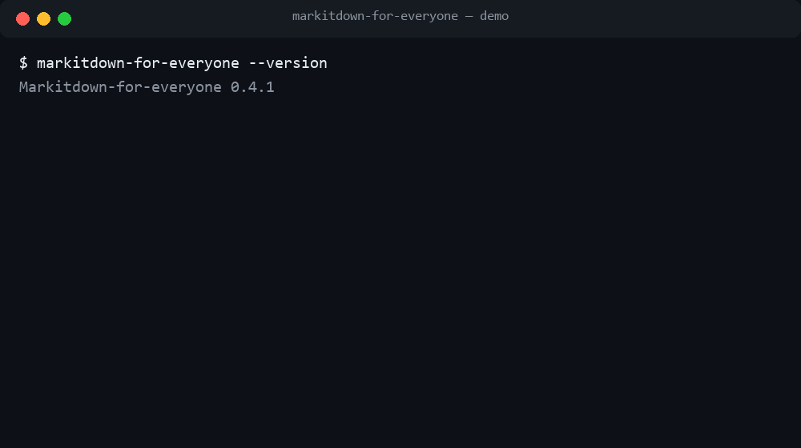

# Markitdown-for-Everyone

[](https://github.com/soyangelromero/Markitdown-for-Everyone/actions/workflows/ci.yml)
[](https://www.python.org/downloads/)
[](LICENSE)
[](CHANGELOG.md)

**Español** · [English](README.md)

**Convierte PDFs escaneados, imágenes y documentos de Office a Markdown desde tu terminal, con una clave gratuita de Pollinations.** OCR incluido, sin GPU ni Docker, bilingüe (español/inglés), con menú interactivo y opciones para scripts.



> Proyecto independiente construido sobre [MarkItDown](https://github.com/microsoft/markitdown) de Microsoft. No está afiliado a Microsoft. Consulta [Créditos](#créditos).

## ¿Por qué esta herramienta?

| | **Markitdown-for-Everyone** | MarkItDown CLI (base) | Conversores online |
|---|---|---|---|
| Clave gratuita de Pollinations, sin cuenta OpenAI/Azure | ✅ | ❌ (trae tu clave LLM) | varía |
| OCR de PDFs escaneados sin configuración extra | ✅ incluido | ⚠️ instalar/configurar `markitdown-ocr` + LLM | ✅ pero de pago/subida |
| Interfaz bilingüe y prompts de OCR localizados | ✅ ES/EN | ❌ solo inglés | varía |
| Se ejecuta en local, sin GPU, sin Docker, sin subir archivos | ✅ | ✅ | ❌ sube los archivos |
| Menú interactivo **y** opciones no interactivas | ✅ | solo flags | solo GUI |
| Coste aproximado | ~0,0002 pollen por documento con LLM | depende del proveedor | suscripción |

La idea no es reemplazar MarkItDown: lo envuelve con un backend Pollinations listo para usar, OCR activado por defecto, una experiencia bilingüe y un menú que cualquier persona puede seguir.

## Características

- Convierte PDF, DOCX, PPTX, XLSX/XLS, imágenes, audio, HTML, CSV, JSON, XML, EPUB y ZIP.
- **PDFs escaneados e imágenes embebidas** se procesan con OCR mediante un LLM con visión
  (plugin `markitdown-ocr`), con reintento página a página para PDFs sin texto seleccionable.
- **Interfaz bilingüe** (español/inglés) con detección automática del idioma del sistema y
  preferencia guardada.
- **Catálogo de modelos en vivo**: recomienda modelos del catálogo de Pollinations y marca
  cuáles aceptan imágenes y cuáles requieren pollen de pago.
- **Funciona sin clave API para formatos de texto** (`.txt`, `.md`, `.csv`, `.json`,
  `.html`, ...); la clave solo es obligatoria para imágenes y recomendable para OCR.
- Guarda la clave y los modelos una sola vez; `POLLINATIONS_API_KEY` los reemplaza sin
  escribirse nunca en disco.
- Reintentos con espera progresiva para errores de red, HTTP 5xx y 429 (respetando
  `Retry-After`), con mensajes claros para 401/402/403/404.
- Preparada para scripts: `--yes`, `--non-interactive`, `--quiet`, códigos de salida
  estables, sin ANSI cuando la salida está redirigida y errores amigables si stdin está
  cerrado.
- Escritura atómica de la configuración con permisos de solo dueño en Linux/macOS.

## Instalación

Requiere **Python 3.10+** y conexión a internet para las conversiones con LLM.

### Instalación en una línea

```bash
# CLI aislada con uv (recomendado)
uvx --from git+https://github.com/soyangelromero/Markitdown-for-Everyone.git markitdown-for-everyone

# O instálala como herramienta con pipx
pipx install git+https://github.com/soyangelromero/Markitdown-for-Everyone.git
```

> **La publicación en PyPI está pendiente.** Mientras tanto, instala desde Git como arriba o
> descarga el wheel de la [última release](https://github.com/soyangelromero/Markitdown-for-Everyone/releases)
> y ejecuta `pipx install ./markitdown_for_everyone-0.4.1-py3-none-any.whl`.

### Desde un clon (desarrollo)

```bash
git clone https://github.com/soyangelromero/Markitdown-for-Everyone.git
cd Markitdown-for-Everyone
python -m venv .venv

# Windows
.venv\Scripts\activate

# macOS / Linux
source .venv/bin/activate

pip install -e .
```

### Obtener una clave API

Crea una clave secreta (`sk_...`) en [enter.pollinations.ai](https://enter.pollinations.ai).
Crear la clave es gratis; el uso se paga con **Pollen**. Sirven tanto las recompensas de
quests como las claves prepagadas. Algunos modelos son gratuitos (`openai`, `openai-fast`,
`deepseek`); muchos modelos de visión (`gemini`, `claude`, `qwen-vision`, ...) requieren
pollen de pago — ejecuta `--list-models` para ver las etiquetas actuales.

Si prefieres no guardarla en disco:

```bash
export POLLINATIONS_API_KEY="sk_tu_clave"        # macOS / Linux
$env:POLLINATIONS_API_KEY = "sk_tu_clave"        # Windows PowerShell
```

## Uso

Abre el menú interactivo:

```bash
markitdown-for-everyone
```

Convierte un archivo directamente:

```bash
markitdown-for-everyone informe.pdf -o informe.md -m openai
markitdown-for-everyone foto.jpg --yes
```

También funciona como módulo y desde el script del repositorio:

```bash
python -m markitdown_pollinations informe.pdf
python markitdown_for_everyone.py informe.pdf
```

En el primer arranque se pregunta el idioma, la clave API (oculta al escribir) y los modelos
de texto/visión. Las elecciones se guardan en `config.json` dentro del directorio de
configuración del usuario:

- Windows: `%LOCALAPPDATA%\AngelRomero\markitdown-for-everyone\config.json`
- Linux: `~/.config/markitdown-for-everyone/config.json`
- macOS: `~/Library/Application Support/markitdown-for-everyone/config.json`

Escribe `c`, `cancel`, `b`, `back`, `s`, `salir`, `volver` o `q` para volver atrás.
El menú interactivo espera un número (1–5).

### Opciones

| Opción | Descripción |
|---|---|
| `FILE` | Archivo a convertir (si se omite, se abre el menú interactivo) |
| `-o, --output FILE` | Archivo Markdown de salida (por defecto: la ruta de entrada con `.md`) |
| `-k, --api-key KEY` | Clave de Pollinations para esta ejecución |
| `-m, --model MODEL` | Modelo para esta ejecución (por defecto: el de la configuración u `openai`) |
| `-l, --language {en,es}` | Idioma de la interfaz (por defecto: preferencia guardada o idioma del sistema) |
| `--configure` | Abrir el flujo de configuración |
| `--list-models` | Mostrar modelos recomendados con etiquetas de visión/pago y salir |
| `-y, --yes` | Sobrescribir la salida sin preguntar |
| `--non-interactive` | No preguntar nunca; salir con código 2 si se requiere entrada |
| `-q, --quiet` | Ocultar el banner y el indicador de progreso |
| `-v, --verbose` | Mensajes informativos a stderr |
| `-d, --debug` | Mensajes de depuración a stderr |
| `--version` | Mostrar la versión y salir |
| `-h, --help` | Mostrar ayuda (localizada con `--language` o el idioma guardado) |

### Códigos de salida

| Código | Significado |
|---|---|
| `0` | Éxito, o cancelación por parte del usuario |
| `1` | Error de conversión o de configuración |
| `2` | Invocación inválida o entrada interactiva requerida en modo no interactivo |
| `3` | La conversión no produjo contenido, no se escribió archivo |
| `130` | Interrumpido con Ctrl+C |

### Variables de entorno

| Variable | Propósito |
|---|---|
| `POLLINATIONS_API_KEY` | Clave para esta ejecución; **nunca** se guarda en `config.json`. |
| `NO_COLOR` | Desactiva los colores ANSI. |
| `FORCE_COLOR` | Fuerza colores ANSI aunque la salida no sea una terminal. |
| `NO_CLEAR` | Desactiva el borrado de pantalla. |

### Ejemplos

```bash
# Convertir todos los PDF de una carpeta (PowerShell)
Get-ChildItem *.pdf | ForEach-Object { markitdown-for-everyone $_.FullName --yes }

# Usar un modelo de visión de pago para un lote de fotos
POLLINATIONS_API_KEY="sk_..." markitdown-for-everyone scan.jpg -m gemini --yes

# Configurar sin tocar la clave guardada
POLLINATIONS_API_KEY="sk_..." markitdown-for-everyone --configure

# No interactivo: fallar en lugar de preguntar si la salida ya existe
markitdown-for-everyone informe.pdf --non-interactive
```

## Modelos

`--list-models` muestra las recomendaciones con etiquetas de capacidad en vivo, por ejemplo:

```text
Modelo para documentos de texto:
  - openai (visión)
  - openai-fast (visión)
  - deepseek
  - mistral (visión, de pago)
  - glm (de pago)

Modelo para imágenes:
  - openai (visión)
  - openai-large (visión)
  ...
```

Los IDs de Pollinations están migrando a nombres canónicos `publisher/model`; los alias que
se usan aquí (`openai`, `gemini`, `claude`, ...) siguen aceptándose. El CLI consulta el
catálogo público al configurar (caché de 5 minutos y lista integrada cuando no hay red).

**Consejo para PDFs escaneados:** el plugin de OCR usa el modelo elegido para documentos de
texto. Elige uno que acepte imágenes (por ejemplo `openai`) o el CLI reintentará la
conversión con el modelo de visión cuando el resultado esté vacío.

## Seguridad

- `config.json` está fuera del repositorio y contiene la clave API en **texto plano**. En
  Linux/macOS se escribe de forma atómica con permisos `0600`. En Windows protege el archivo
  la ACL de tu perfil de usuario.
- Las claves pasadas por `POLLINATIONS_API_KEY` no se escriben nunca en disco: al guardar la
  configuración se conserva la clave que ya estuviera guardada.
- Pasar `-k/--api-key` expone la clave en la lista de procesos y en el historial del shell.
  En máquinas compartidas prefiere la variable de entorno o `--configure`.
- La clave se envía solo en la cabecera `Authorization`, nunca en una URL.
- La integración con el llavero del sistema (Credential Manager / Keychain / Secret
  Service) está en la hoja de ruta.

## Solución de problemas

| Síntoma | Qué hacer |
|---|---|
| `401` / "Clave API inválida" | Regenera la clave en [enter.pollinations.ai](https://enter.pollinations.ai). |
| `402` / "Saldo de pollen insuficiente" | Recarga pollen o elige un modelo gratuito (`openai`, `openai-fast`, `deepseek`). |
| `403` / "Permiso denegado" | La clave no tiene permiso para ese modelo; elige otro. |
| `429` / "Límite de velocidad excedido" | Espera el tiempo de `Retry-After`; el CLI reintenta automáticamente. |
| Timeout / error de conexión | Revisa la conexión; los PDFs escaneados grandes necesitan varias llamadas al LLM. |
| "No se produjo contenido" | El archivo puede ser un PDF escaneado o un formato no soportado; prueba un modelo de visión. |
| Catálogo de modelos no disponible | El CLI usa su lista integrada; las conversiones siguen funcionando. |
| Sin salida al redirigir | Colores y spinner se desactivan cuando stdout no es una terminal. |
| Falla la conversión de audio | `pydub` (instalado con el extra `audio-transcription`) necesita `ffmpeg` en el `PATH`. |

## Desarrollo

```bash
pip install -e ".[dev]"
pre-commit install          # opcional: ejecutar comprobaciones antes de cada commit

ruff check .
ruff format --check .
mypy src
pytest -q --cov
```

El proyecto soporta Python 3.10–3.13. La CI ejecuta lint, tipos y pruebas en Ubuntu, Windows
y macOS.

La animación del README se genera a partir de la salida real del CLI:

```bash
python scripts/generate_demo.py   # genera docs/demo.gif y docs/demo.png
```

### Estructura del proyecto

```text
src/markitdown_pollinations/
├── cli.py                  # argparse, menú, prompts, códigos de salida
├── config.py               # configuración con platformdirs, validación, escritura atómica
├── constants.py            # endpoints, modelos, colores, códigos de salida
├── converter.py            # MarkItDown + mapeo de errores + reintentos
├── i18n.py                 # diccionarios español/inglés
├── models.py               # catálogo de modelos en vivo (con respaldo sin red)
├── pollinations_client.py  # factoría del cliente OpenAI-compatible
└── validation.py           # validación de la clave API
tests/                      # suite pytest (más de 90 % de cobertura)
```

## Contribuir

Se aceptan reportes de bugs, ideas y pull requests. Consulta
[CONTRIBUTING.md](CONTRIBUTING.md) y [SECURITY.md](SECURITY.md) antes de abrir un issue.

## Registro de cambios

Consulta [CHANGELOG.md](CHANGELOG.md). Historial: `0.4.1` (actual), `0.4.0`, `0.3.1` y anteriores.

## Licencia

Licencia MIT. Consulta [LICENSE](LICENSE).

## Créditos

- [MarkItDown](https://github.com/microsoft/markitdown) de Microsoft
- [Pollinations AI](https://pollinations.ai)
