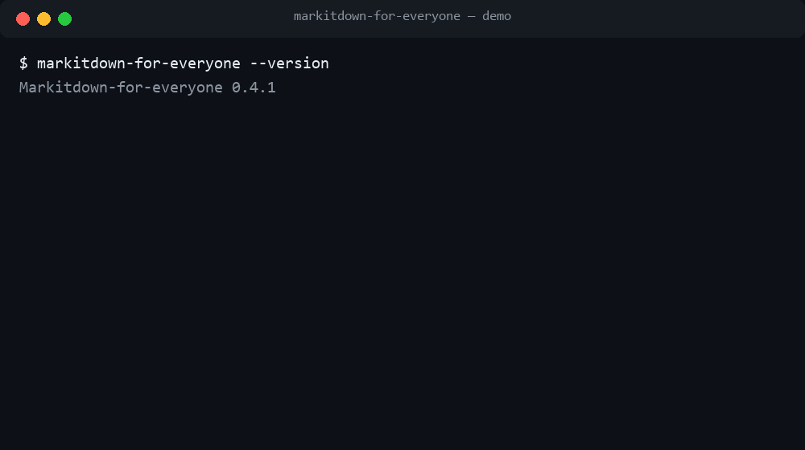

# Markitdown-for-Everyone

[](https://github.com/soyangelromero/Markitdown-for-Everyone/actions/workflows/ci.yml)
[](https://www.python.org/downloads/)
[](LICENSE)
[](CHANGELOG.md)

**English** · [Español](README.es.md)

**Convert scanned PDFs, images and Office documents to Markdown from your terminal, using a free Pollinations API key.** OCR included, no GPU or Docker required, bilingual (English/Spanish), with an interactive menu and script-friendly flags.



> Independent open-source project built on top of Microsoft's [MarkItDown](https://github.com/microsoft/markitdown). It is not affiliated with Microsoft. See [Credits](#credits).

## Why this tool?

| | **Markitdown-for-Everyone** | MarkItDown CLI (bare) | Online converters |
|---|---|---|---|
| Free Pollinations key, no OpenAI/Azure account needed | ✅ | ❌ (bring your own LLM key) | varies |
| Scanned PDF OCR without extra setup | ✅ bundled | ⚠️ install/configure `markitdown-ocr` + LLM | ✅ but paid/upload |
| Bilingual interface and localized OCR prompts | ✅ EN/ES | ❌ English only | varies |
| Runs locally, no GPU, no Docker, no upload UI | ✅ | ✅ | ❌ files uploaded |
| Interactive menu **and** non-interactive flags | ✅ | flags only | GUI only |
| Approximate cost | ~0.0002 pollen per LLM-backed document | depends on provider | subscription |

The goal is not to replace MarkItDown: it wraps it with a zero-setup Pollinations backend, OCR enabled by default, a bilingual UX and a menu that a non-technical user can follow.

## Features

- Converts PDF, DOCX, PPTX, XLSX/XLS, images, audio, HTML, CSV, JSON, XML, EPUB and ZIP.
- **Scanned PDFs and embedded images** are OCR'd through a vision-capable LLM
  (`markitdown-ocr` plugin) with a page-by-page fallback for PDFs without selectable text.
- **Bilingual interface** (English/Spanish) with automatic system-language detection and a
  saved preference.
- **Live model catalog**: recommends models from the Pollinations catalog and marks
  which ones accept images and which require paid pollen.
- **Works without an API key for text-based formats** (`.txt`, `.md`, `.csv`, `.json`,
  `.html`, ...); a key is only required for images and recommended for OCR.
- API key and model choices are stored once; `POLLINATIONS_API_KEY` overrides them without
  ever being written to disk.
- Retries with backoff on network errors, HTTP 5xx and 429 (honoring `Retry-After`), with
  clear messages for 401/402/403/404.
- Script-friendly: `--yes`, `--non-interactive`, `--quiet`, stable exit codes, no ANSI
  output when piped, and friendly errors instead of tracebacks when stdin is closed.
- Atomic config writes with owner-only permissions on Linux/macOS.

## Install

Requires **Python 3.10+** and an internet connection for LLM-backed conversions.

### One-line install

```bash
# Isolated CLI with uv (recommended)
uvx --from git+https://github.com/soyangelromero/Markitdown-for-Everyone.git markitdown-for-everyone

# Or install it as a tool with pipx
pipx install git+https://github.com/soyangelromero/Markitdown-for-Everyone.git
```

> **PyPI publication is pending.** Until then, install from Git as above, or download the
> wheel from the [latest release](https://github.com/soyangelromero/Markitdown-for-Everyone/releases)
> and run `pipx install ./markitdown_for_everyone-0.4.1-py3-none-any.whl`.

### From a clone (development)

```bash
git clone https://github.com/soyangelromero/Markitdown-for-Everyone.git
cd Markitdown-for-Everyone
python -m venv .venv

# Windows
.venv\Scripts\activate

# macOS / Linux
source .venv/bin/activate

pip install -e .
```

### Get an API key

Create a secret key (`sk_...`) at [enter.pollinations.ai](https://enter.pollinations.ai).
Key creation is free; usage is paid with **Pollen**. Quest rewards and prepaid keys both
work. Some models are free (`openai`, `openai-fast`, `deepseek`), while many vision models
(`gemini`, `claude`, `qwen-vision`, ...) require paid pollen — run `--list-models` to see
the current tags.

Export the key instead of storing it, if you prefer:

```bash
export POLLINATIONS_API_KEY="sk_your_key"        # macOS / Linux
$env:POLLINATIONS_API_KEY = "sk_your_key"        # Windows PowerShell
```

## Usage

Start the interactive menu:

```bash
markitdown-for-everyone
```

Convert a file directly:

```bash
markitdown-for-everyone report.pdf -o report.md -m openai
markitdown-for-everyone photo.jpg --yes
```

The package also works as a module and from the repository entry script:

```bash
python -m markitdown_pollinations report.pdf
python markitdown_for_everyone.py report.pdf
```

On the first run you are asked for the interface language, the API key (hidden while
typing) and the text/vision models. Choices are saved to `config.json` in your platform's
user config directory:

- Windows: `%LOCALAPPDATA%\AngelRomero\markitdown-for-everyone\config.json`
- Linux: `~/.config/markitdown-for-everyone/config.json`
- macOS: `~/Library/Application Support/markitdown-for-everyone/config.json`

Type `c`, `cancel`, `b`, `back`, `s`, `salir`, `volver` or `q` at a prompt to go back.
The interactive menu expects a number (1–5).

### Options

| Flag | Description |
|---|---|
| `FILE` | File to convert (if omitted, the interactive menu opens) |
| `-o, --output FILE` | Output Markdown file (default: input path with `.md`) |
| `-k, --api-key KEY` | Pollinations API key for this run |
| `-m, --model MODEL` | Model for this run (default: from config or `openai`) |
| `-l, --language {en,es}` | Interface language (default: saved preference or system locale) |
| `--configure` | Open the configuration flow |
| `--list-models` | Show recommended models with vision/paid tags and exit |
| `-y, --yes` | Overwrite existing output without asking |
| `--non-interactive` | Never prompt; fail with exit code 2 if input is required |
| `-q, --quiet` | Hide the banner and progress spinner |
| `-v, --verbose` | Info-level logging to stderr |
| `-d, --debug` | Debug-level logging to stderr |
| `--version` | Show version and exit |
| `-h, --help` | Show help (localized when `--language` or the saved language is set) |

### Exit codes

| Code | Meaning |
|---|---|
| `0` | Success, or a user-cancelled prompt |
| `1` | Conversion or configuration error |
| `2` | Invalid invocation or interactive input required in non-interactive mode |
| `3` | Conversion produced no content, so no file was written |
| `130` | Interrupted with Ctrl+C |

### Environment variables

| Variable | Purpose |
|---|---|
| `POLLINATIONS_API_KEY` | Key for this run; **never** persisted to `config.json`. |
| `NO_COLOR` | Disable ANSI colors. |
| `FORCE_COLOR` | Emit ANSI colors even when stdout is not a TTY. |
| `NO_CLEAR` | Disable terminal clearing. |

### Examples

```bash
# Convert every PDF in a folder (PowerShell)
Get-ChildItem *.pdf | ForEach-Object { markitdown-for-everyone $_.FullName --yes }

# Use a paid vision model for a batch of photos
POLLINATIONS_API_KEY="sk_..." markitdown-for-everyone scan.jpg -m gemini --yes

# Configure without touching the saved key
POLLINATIONS_API_KEY="sk_..." markitdown-for-everyone --configure

# Non-interactive: fail instead of prompting if the output exists
markitdown-for-everyone report.pdf --non-interactive
```

## Models

`--list-models` prints the recommendations with live capability tags, for example:

```text
Model for text documents:
  - openai (vision)
  - openai-fast (vision)
  - deepseek
  - mistral (vision, paid)
  - glm (paid)

Model for images:
  - openai (vision)
  - openai-large (vision)
  ...
```

Pollinations model IDs are migrating to canonical `publisher/model` names; the aliases used
here (`openai`, `gemini`, `claude`, ...) remain accepted. The CLI fetches the public catalog
when configuring (with a 5-minute cache and a built-in fallback when offline).

**Tip for scanned PDFs:** the OCR plugin uses the model selected for text documents. Pick a
model that accepts images (for example `openai`) or the CLI will retry the conversion with
the vision model when the result is empty.

## Security

- `config.json` is stored outside the repository and contains the API key in **plain text**.
  On Linux/macOS it is written atomically with `0600` permissions. On Windows, ACLs of your
  user profile protect it.
- Keys supplied through `POLLINATIONS_API_KEY` are never written to disk: saving settings
  preserves the previously stored key instead.
- Passing `-k/--api-key` exposes the key in the process list and shell history. Prefer the
  environment variable or `--configure` on shared machines.
- The key is sent only in the `Authorization` header, never in a URL.
- OS keyring integration (Credential Manager / Keychain / Secret Service) is on the roadmap.

## Troubleshooting

| Symptom | What to do |
|---|---|
| `401` / "Invalid API key" | Regenerate the key at [enter.pollinations.ai](https://enter.pollinations.ai). |
| `402` / "Insufficient pollen" | Top up Pollen or choose a free model (`openai`, `openai-fast`, `deepseek`). |
| `403` / "Permission denied" | The key lacks permission for that model; pick another model. |
| `429` / "Rate limit exceeded" | Wait for the `Retry-After` period; the CLI retries automatically. |
| Timeout / connection error | Check your connection; large scanned PDFs may need several LLM calls. |
| "No content was produced" | The file may be a scanned PDF or unsupported; try a vision model. |
| Live model catalog unavailable | The CLI falls back to its built-in list; conversions still work. |
| No output in a pipe | Colors/spinner are disabled when stdout is not a TTY. |
| Audio conversion fails | `pydub` (installed via the `audio-transcription` extra) needs `ffmpeg` in `PATH`. |

## Development

```bash
pip install -e ".[dev]"
pre-commit install          # optional: run checks before each commit

ruff check .
ruff format --check .
mypy src
pytest -q --cov
```

The project targets Python 3.10–3.13. CI runs lint/type checks plus the test suite on
Ubuntu, Windows and macOS.

The README animation is generated from real CLI output:

```bash
python scripts/generate_demo.py   # writes docs/demo.gif and docs/demo.png
```

### Project structure

```text
src/markitdown_pollinations/
├── cli.py                  # argparse, menu, prompts, exit codes
├── config.py               # platformdirs config, validation, atomic writes
├── constants.py            # endpoints, models, colors, exit codes
├── converter.py            # MarkItDown + error mapping + retries
├── i18n.py                 # English/Spanish dictionaries
├── models.py               # live model catalog (with offline fallback)
├── pollinations_client.py  # OpenAI-compatible client factory
└── validation.py           # API-key validation
tests/                      # pytest suite (90%+ coverage)
```

## Contributing

Bug reports, feature requests and pull requests are welcome. See
[CONTRIBUTING.md](CONTRIBUTING.md) and [SECURITY.md](SECURITY.md) before opening an issue.

## Changelog

See [CHANGELOG.md](CHANGELOG.md). Version history: `0.4.1` (current), `0.4.0`, `0.3.1` and earlier.

## License

MIT License. See [LICENSE](LICENSE).

## Credits

- [MarkItDown](https://github.com/microsoft/markitdown) by Microsoft
- [Pollinations AI](https://pollinations.ai)
